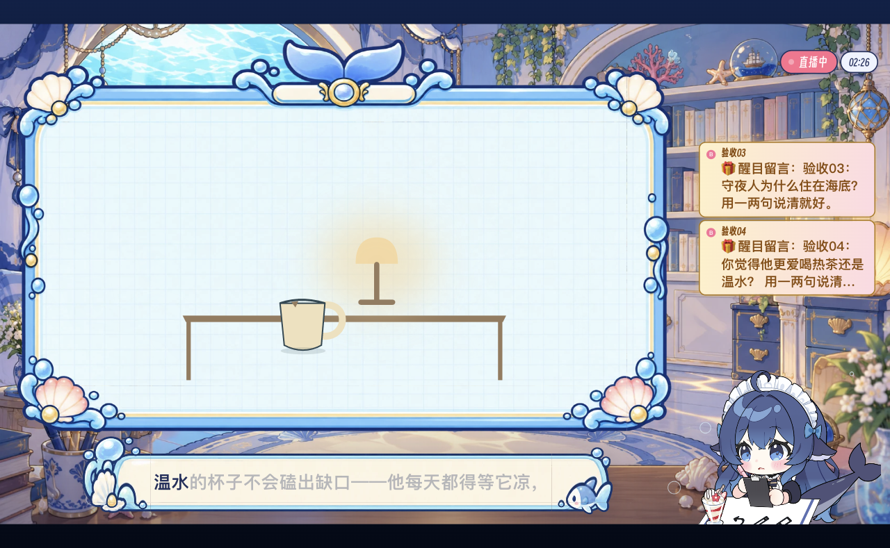

# 2026-11-07 舞台联调与预算保护

**尚未全部验收通过。** 本轮确认真实制作候选、导播备场与送播、播放器发声和预算自动停机；不能据此关闭 #38。

## 已证实的链路

OpenCode ds 四岗位独立启动。制作席真实编译并发布 layered-stage 灯、桌、杯组件候选；恢复已就绪检查点后，导播自主 prepare → ready → take，节目通道进入 program，取得实际绘制回执。下面是实际浏览器截图。候选制作与送播跨受限轮次，不把它计为连续端到端时延。

## 连续互动试验

原定 30 条，每 15 秒一条，本地模拟观众、不接外部直播间。达到累计输入预算后自动停机，实际注入 **12 条**；模型调用 **158 次**，累计序列化输入 **11911257 字节**。输入包含缓存命中内容，不是账单。实际结算输出 27264 token；另保留 29248 个未知输出预留，这不是实际输出量。

12 条关联且实际播完的首响：P50 **3.505 秒**、P95 **5.944 秒**，未达到 P95≤5 秒。8 条取得 finish 且播完；标签不等于语义通过。新的 3 条画面提议尚无一一关联的绘制兑现，不能用画面看起来有变化代替回执。旧轮次的一条灯光请求有已关联的实际 patch 回执，不混入本轮统计。

慢样本 03：1.941 秒提交短句、3.618 秒取得TTS首音频、5.944 秒实际开口；慢样本 04：2.084 秒提交、3.151 秒首音频、5.221 秒开口。延迟同时含模型、语音合成和等待自然交接，不能归为单一瓶颈。

| 输入 | 开口延迟/ms | finish 实际播完 | 语义审阅 |
|---|---:|---|---|
| 1 | 3379 | 未取得 | 展开回答被后续输入打断，窗口内未完成。 |
| 2 | 3016 | 播完 | 相关且展开回答播完，但首响说风吹撞，展开改为磕，设定不一致。 |
| 3 | 5944 | 未取得 | 只播出无具体内容的评价；未回答为何住海底。后续代码已拦截该前缀，尚未重跑。 |
| 4 | 5221 | 播完 | 首响温水，展开热茶，偏好矛盾；后续收紧首响不先决定二选一。 |
| 5 | 4179 | 播完 | 回答相关且播完，但首响与展开给了不同便签文本。 |
| 6 | 3151 | 播完 | 确认原创，相关且播完。绝对措辞“一个字没抄”缺少可核验依据。 |
| 7 | 3417 | 播完 | 明确虚构，相关且播完。 |
| 8 | 2791 | 播完 | 口头答清方案；没有本条请求对应的绘制兑现证据。 |
| 9 | 3168 | 播完 | 口头答清且明确尚未兑现；缺少关联绘制证据。 |
| 10 | 4365 | 播完 | 口头回应保留杯子，实际画面中杯子保留；无本条关联绘制证据。 |
| 11 | 4084 | 未取得 | 只有接话，未取得本条后续完成回执。 |
| 12 | 3505 | 未取得 | 首响本身已给出具体台词，但没有 finish 标签；预算停机后不推断后续。 |

## 后续代码与验证范围

共享预算、取消、并发预留和保守结算已接入运行时；取消几秒一次的导播/制作空闲巡场，发布依赖后唤醒可执行制作。候选 ID 错误返回可用 ID，明确首个 layered-stage 同样需要备场再送播。备场最多等待浏览器连接 10 秒，连接对账不销毁仍在备场的实例。

上述实测后继续补了：Cue 的 proposalIds 随实际参数补丁进入兑现链；正常开口/结束由原生时钟派发 Cue，减少导播模型唤醒；缩小非制作岗位的模型可见历史；拦截无内容的夸赞式首响，约束即时首响不先发明事实或决定二选一。后三类修改仅有离线回归，不冒充新的实测效果。

仍需修正后的 30 条语义与时延、逐请求视觉兑现、下一方向预备与跨场次衔接验收。所有模型进程在测试后停止。详见[逐条数据](2026-11-07-harness-report.json)与[运行时预算说明](../live-model-route.md)。
