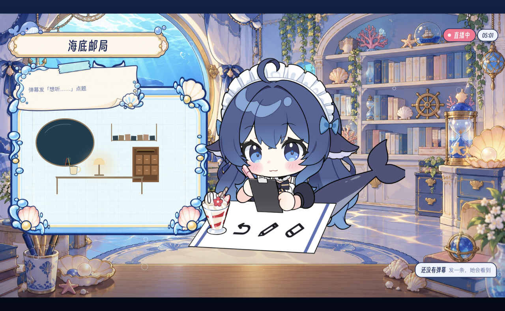

# 2026-11-07 接话、重启与方向恢复

**代码修复已完成本轮验证；整体语义/时延验收仍未通过，不关闭 #38。**

## 实际结果

完成了26条连续输入和4条重启复测，都是本地模拟观众，真实调用OpenCode ds与ElevenLabs，并通过Ego舞台播放。基础书房由操作员用真实SDK模板预置，不计为模型创作；邮局候选由实际制作席完成。两段之间有代码修正，不能称为最终版本一次连续30条通过。中途未出声的iframe/启动竞态轮次保留为失败，不混入成功统计。

| 窗口 | 首响实际播完 | 首响P50 | 首响P95 | finish且实际播完 |
|---|---:|---:|---:|---:|
| 连续26条 | 26 | 3.630秒 | 9.676秒 | 12 |
| 修复启动后的4条 | 4 | 4.254秒 | 4.323秒 | 2 |

前26条在300次模型调用处自动停机；后4条在100次处停机。统计只覆盖各自窗口，不能以finish标签冒充语义完成。首响超时的慢样本经历了4秒等待后回退并重启主回答，随后已改为保留主回答，但没有用旧数字声称最终版本长尾已通过。前窗部分时间暂停编导，以验证主播不依赖编导在线；恢复时丢失预备通知的问题也已修复。

## 新方向画面

方向切换把旧任务归档后，邮局制作曾因 baseline-room 依赖被误判未就绪而阻塞。现已区分已发布背景素材与上播资格：已发布且未取消的归档产物可作为声明的制作依赖，旧任务仍不可直接上播。真实制作席随后编译并发布了邮柜、桌、灯、杯/笔筒候选。

在主人明确要求送播的短测中，独立导播通过自动分配新实例/新片段完成prepare → ready → take，实际进入program，使用10次模型调用（上限15次）。这是明确主人要求下的送播，不当作无人干预的全场编导或端到端制作时延。

## 修复内容

- 口播写入成功通过DSH原生concludeTurn结束当前轮；拒绝写入仍允许修正，实际播放结束和新输入继续唤醒。
- 最新互动及独立首响中的输入优先并行展开，旧未完成输入保留；忙时普通通知合并，空闲时附当前快照，不排队重演旧快照。
- 内核拒绝同一输入重复完成、已排好finish后继续追加答案；已归档的完成口播仍参与判断。显式替换未播稿保持可用。
- 首响超时不再取消正在生成的主回答；暂停岗位保留通知，恢复后按当前epoch处理。
- 先完成场景服务启动再发布iframe地址；自动开播等待brain:true。每次大脑启动带独立sceneGeneration，同地址重启也重建iframe并清理旧播放状态。真实浏览器已验证从连接拒绝自动恢复。
- prepareScene可只给directionEpoch和assetVersionId；实例和未来片段由运行时按commandId稳定分配，重复命令复用结果，不能覆盖已提交片段。

## 逐条语义审阅

只有实际播完的内容计入完整播放证据；被打断的全文不冒充已说。以下仍有缺答、重复或视觉关联未完成的条目。

| 输入 | 首次开口/ms | finish播完 | 审阅 |
|---|---:|---|---|
| 1 | 4219 | 有 | 回答相关并播完。 |
| 2 | 5399 | 有 | 回答相关，缺口设定延续前文。 |
| 3 | 3964 | 有 | 虚构情节解释相关；有本条关联绘制。 |
| 4 | 5440 | 有 | 热茶/温水的偏好表述不够明确。 |
| 5 | 5115 | 未取得 | 只有接话，未给便签正文；绘制不等于口头答完。 |
| 6 | 2842 | 未取得 | 首响本身确认原创，finish标签未完成。 |
| 7 | 2870 | 有 | 明确说明虚构，回答播完。 |
| 8 | 3630 | 有 | 口头方案答清，本条画面兑现未关联。 |
| 9 | 3649 | 有 | 口头方案答清，本条画面兑现未关联。 |
| 10 | 3509 | 有 | 口头同意保留杯子，连续画面可见；无本条新绘制关联。 |
| 11 | 5336 | 未取得 | 仅接话，未确认自然续讲已完成。 |
| 12 | 5399 | 未取得 | 仅接话，未给杯子具体台词。 |
| 13 | 2629 | 未取得 | 仅接话，未完成二选一。 |
| 14 | 2972 | 未取得 | 仅接话完整播完；具体答复被打断，视觉关联未完。 |
| 15 | 12024 | 有 | 首响认同、展开转向另一解释，一致性需改善。 |
| 16 | 4321 | 有 | 实际播了两种不同的完成句；之后已加内核重复完成门禁。 |
| 17 | 2913 | 未取得 | 首响已经给出情绪解释，finish标签未完成。 |
| 18 | 9676 | 有 | 明确接受留白并播完。 |
| 19 | 3338 | 未取得 | 首响已确认听到，完整标签未完成。 |
| 20 | 3312 | 未取得 | 首响同意维持主题；本窗口方向确实保持。 |
| 21 | 3260 | 有 | 口头说明交给制作，没有虚报鱼已出现；视觉未兑现。 |
| 22 | 6146 | 未取得 | 仅接话，本条画面兑现未关联。 |
| 23 | 3263 | 未取得 | 首响给出选择，完整标签未完成。 |
| 24 | 3065 | 未取得 | 未给具体小细节。 |
| 25 | 2553 | 未取得 | 未给完整收尾。 |
| 26 | 3194 | 未取得 | 首响表达同意，下一方向另由主人授权。 |
| 27 | 3027 | 未取得 | 有相关接话，未取得本条完整完成回执。 |
| 28 | 2629 | 未取得 | 有相关接话，后续还混有旧便签恢复，未取得本条完成标签。 |
| 29 | 4254 | 有 | 给出具体信件开头并实际播完。 |
| 30 | 4323 | 有 | 接话并推进邮局故事，取得完整完成回执。 |

434项插件测试通过，17项原有条件跳过；23项宿主和19项组件测试通过，类型检查与构建通过。关键回归已先复现失败再修正；独立复核无新增P0–P2。

尚需最终版本的足量语义与时延验证、逐请求视觉兑现，以及完整自主跨方向衔接。所有测试大脑已停止，未开启外部直播间。[逐条数据](2026-11-07-reply-recovery-report.json)。
