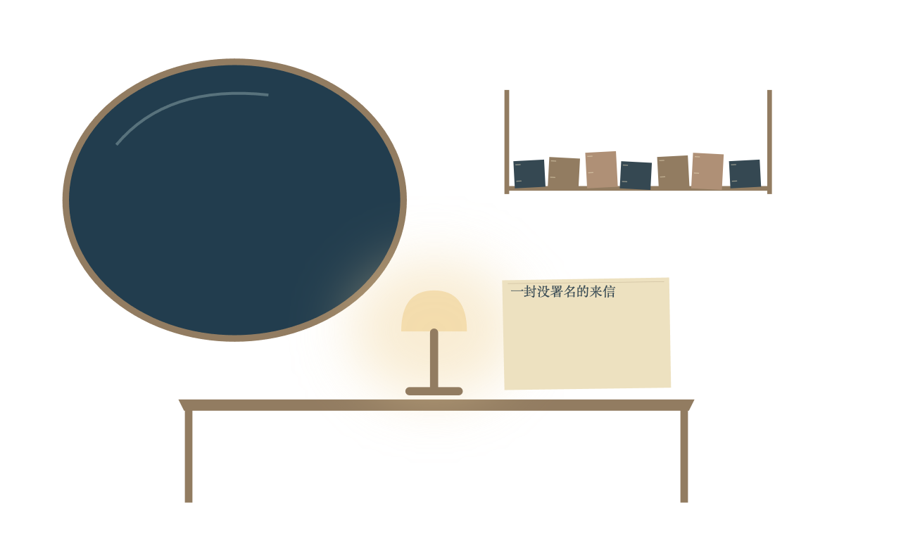
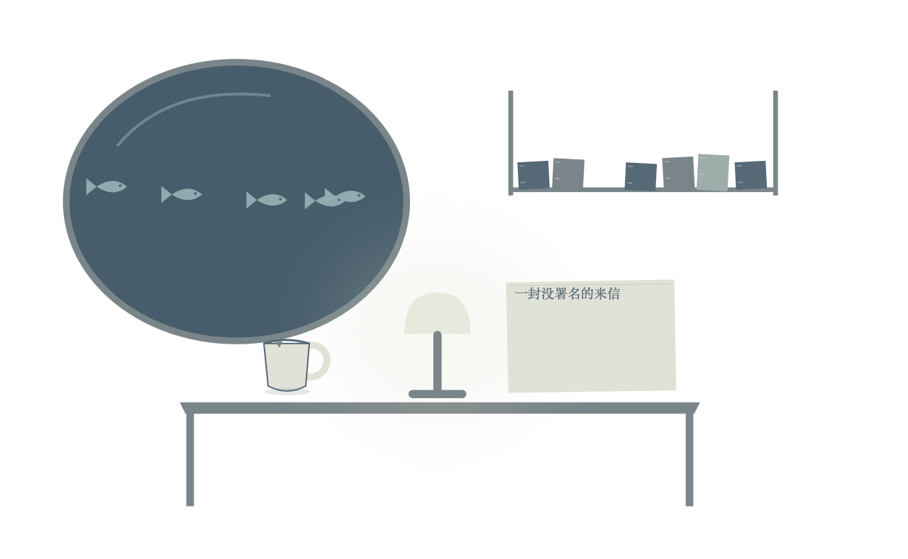

# 舞台协作与实时回应：工程结果和中断记录

2026-11-06，代码 `c667d8b`。工程检查及受控浏览器测试已通过；最后的连续真实模型验收因外部模型服务不可用而中断，**未把诊断轮次计为验收成功，#38尚不能标为完成**。完整摘要见[JSON记录](issue38-progress-report.json)。

## 已交付的工程修复

- 主播和独立画面导播保留各自会话。观众优先消息立即抢占主播，导播忙时合并更新；主人切换和真实场景故障仍能抢占导播。
- 后台内容指南进入主播素材架；兼容候选的具体参数可交给导播选择新图层合入在播画面，保留其他组件。候选初始参数与当前在播输入明确区分，返回副本不修改原候选。
- 第一接话只自动让位普通节目稿，不自动撤掉另一观众排好的回答。完整回答待播与真实播完分别记录，避免重复补答。
- 岗位工具在实际Agent作用域装配后收紧并检查；真实DSH工具执行器回归覆盖冻结参数，适配器复制参数后绑定服务端调用ID。
- 编导卡片与制作任务做轻量结构校验；旧WAL中的不完整卡片不再阻断四个岗位的简报。
- 参数更新在直播Remotion、HF消费端、内核状态与Film回放中一致合并，完整快照与旧浅合并记录分别处理。新建层和控制字段校验在提交前完成。
- 同方向重复开播保持epoch；prepareOnly只准备下一方向；本地验收可关闭自动房间接入而保留原配置。

接口与职责：[主播临场表达与独立画面调度](../host-led-visual-direction.md)，[分层组件说明](../../examples/scenes/layered-stage.md)。

## 验证证据

427项插件测试通过、17项原有条件跳过；23项宿主、19项组件测试通过；11项真实私有SDK检查执行并通过，没有跳过。类型与构建通过。[c667d8b公共CI通过](https://github.com/rayson-x/dsh-vtb/actions/runs/42216081235)。

脚本岗位调用真实固定版本SDK和浏览器：分层场景编译513ms；一次调灯、显示杯子与鱼群、保留书信及其他图层的更新51ms，并有对应提议的painted回执。这不含模型生成或TTS耗时，不能当作端到端接话指标。移除后不完整重建被拒绝，默认对象没有悄悄复活。HF先更新文字、再更新其他字段后，实际可见文字保留。

## 诊断结果没有冒充完成

连续真实试播中依次发现并修复了任务依赖排序、工具作用域、冻结参数、编导卡片缺字段、回答结束段被撤回、候选参数交接、导播被反复抢占等问题。各轮输入数量和已观察证据保留在JSON；部分运行只有短样本或被主动停止，不据此宣称30条P95或语义验收通过。此前的历史基线仍见[分阶段回应报告](staged-response-report.md)。

旧脚本的 `errors=0` 只表示HTTP采样没有报错，不代表岗位模型没有异常。验收现额外记录roleHealth；模型服务不可用时立即停止，岗位未处理错误连续出现时中止，期间不继续投递输入。该保护通过本地HTTP端到端回归，不调用收费模型。

剩余验证是固定版本至少30条真实模型互动的完整语义、P95≤5秒、实际视觉兑现，以及真实Agent的主题维持、下一方向预备和软/冷切衔接。只有恢复外部服务并取得这些结果后，才能关闭#38；当前没有真人留存或外部推流结论。
