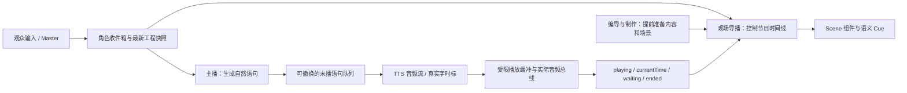

# 实时输出队列

未来节目内容与即时播出分开管理。编导、制作、现场导播、主播保留各自的独立 Agent 会话；确定性运行时负责版本、队列、媒体传输和回执，不增加一个替所有岗位思考的大 loop。

## 队列的边界

- 未来内容时间线允许提前准备当前方向、下一方向和过渡内容，由导播决定上场。它不等于已经提交的口播。
- 主播提交一个自然语句即可入队；不要求先写完整个段落，也不要求持续填满缓冲。重要互动可在首次回应时点名并回答具体内容，之后再展开。
- 未播队列采用约10秒的预计时长预算，最多4句。首次句子可超过估算预算，后续追加受到背压。每字160ms仅是排队估算，不会用来制造真实时标或调整播放速度。语音合成请求最多并行2个，替换请求优先等待空出的合成槽。
- `offerSpeech` 可携带 `replacePending:{partId,expectedRevision}`：一次事务撤掉未提交的旧句及依赖其未念部分的 Cue，并插入新句。版本冲突或旧句已提交时，整次拒绝；不先撤旧句再发现新句不能入队。已开口语句保持自然交接。
- 重要唤醒附有工程快照，主播可直接取得epoch和口播revision，省去为了这些前置条件而重复读取简报的模型往返。普通观察仍可读最新简报。

## 音频按流消费

直播使用 ElevenLabs `stream/with-timestamps` 接口。音频块到达后即进入受限的 progressive HTTP 音频源；浏览器无需等待整个响应或最终缓存文件生成。预备句子也可提前合成，但没有播放命令就不发声。每条音频流最多16MiB，生产者和HTTP消费者均有结束、取消、失败与背压处理；整段成功后再发布完整音频缓存。

词时标必须与请求原文前缀一致且单调递增。`appendSpeechTiming` 只能追加同一音频的已验证前缀，不能重写已知时标。未返回时标的字保持未念；只有实际媒体时间经过已有时标，才推进逐字状态和语义Cue。浏览器 `waiting` 时人物停止张嘴，节目时间不会替代音频时间去追赶。

软切保留已经开始的语音流，取消旧方向的未来缓冲；强切和停止会取消音频流及未执行内容。TTS中途失败会记录失败并停止对应声道，不把半段流当作正常念完。恢复工程不会自动重播过去的语音。

语音仍通过统一节目音轨输出，所以全舞台录制继续采集实际发出的声音。录制与导出不重新合成或补造先前的节目。

## 模型与观测

`ELEVENLABS_LIVE_MODEL_ID` 可为直播独立选择模型；为空则沿用 `ELEVENLABS_MODEL_ID`。音色不变。低延迟试验使用 `eleven_flash_v2_5`，原来的模型设置继续用于其他语音路径。不同模型可能改变表现力，不能把服务商的服务器延迟数字当成本机端到端保证。

`GET /live/timings?after=N` 返回有界、带游标的阶段记录：输入入库、角色唤醒、模型开始及首流块、口播提交、合成排队/开始/首音频/完成、实际播放、缺音等待和结束。只记录关联ID与时间，不记录密钥或模型正文。测试脚本区分TTS请求耗时、合成槽等待和合成后播放等待；真正回应仍以浏览器实际播放为准。

接口依据：[流式音频与时标](https://elevenlabs.io/docs/api-reference/text-to-speech/stream-with-timestamps)、[模型支持范围](https://elevenlabs.io/docs/overview/models)。实现中的缓冲和目标是本项目选择，不是服务商对端到端时延的承诺。

## 分阶段回应与可恢复接话

观众的一个问题不必等一次完整答案：主播先用`acknowledgeInput`写一个具体短语，通常8–18字，再用多个`offerSpeech`逐段回答。`responseTo`指向真实输入，`responseStage=ack/answer/finish`分别表示接住、展开和本次口头回答结束；简单问题一句已答完可以直接complete。队列接受、首次实际开口、完整回答和画面兑现分别计量。`finish`不能替代painted回执。

`pendingReplies`根据真实播放派生，短回应不会清掉后续工作；重启也从WAL恢复这些关系。主播只读自己的轻量简报，不再携带制作候选、源码构建和其他岗位的大型修订表。重要消息与实际播放回执会附工程快照，减少为取得epoch/revision而额外往返模型。

普通A话题正在播放时，如果互动接住语句已有可播音频，运行时才请求交接；不会先停A再等模型或TTS。浏览器利用已验证的标点停顿窗口，在媒体时间进入窗口时暂停；窗口过了就等下一处，时标还没覆盖就等待后续前缀。该机制尽量在自然停顿交接，不承诺音频样本级精确切割，也不按平均字速猜边界。正在回应的互动默认不被同级新消息连续抢断，后续互动排队或聚合。

中断请求固定token。未知/非法回执不能释放声道；只有匹配音频实例与交接请求的真实停止回执，才原子更新最终已读位置、aborted、未念Cue失效和`continuations`。接住音频撤回或流失败时会撤销交接；合法的竞态迟到停止仍留下A的恢复便签。已显示的画面不因主持人插话自动撤下。

便签保存A的已听片段、未读资料、原方向和画面引用。主播根据上下文重新写过渡与后续内容，用新partId和`resumesContinuationIds`接回；不是继续播放旧MP3，也不重放旧Cue。衔接语可呼应观众刚才的内容，不固定套“好，回到刚才”。新语句只有真实playing才消费恢复便签；开口前失败归还便签，开口后失败按实际进度产生后继便签，并保留原资料关联。内容已过时可`discardContinuation`，切换大方向使旧便签失效，不把旧A带回新方向。

验收脚本保留原来的点名口径，并增加首个内容回应、接住、首段展开、口头回答结束、可见兑现五种独立证据。首响数字不能冒充完成答案；内容是否相关、过渡是否自然仍须单独复核。
